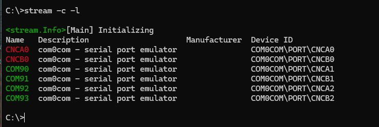
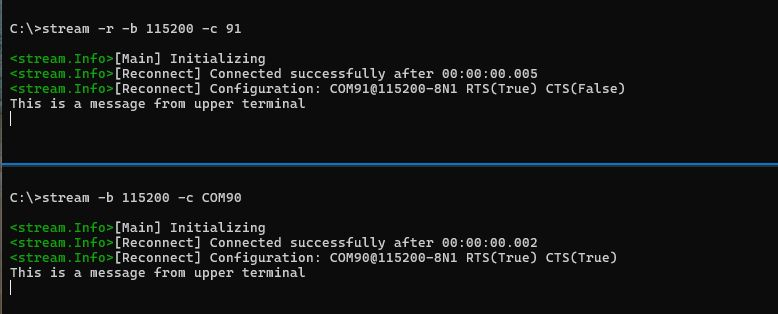
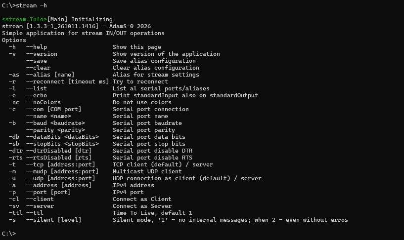
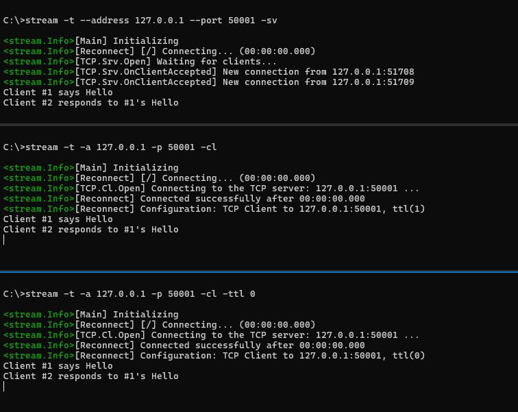
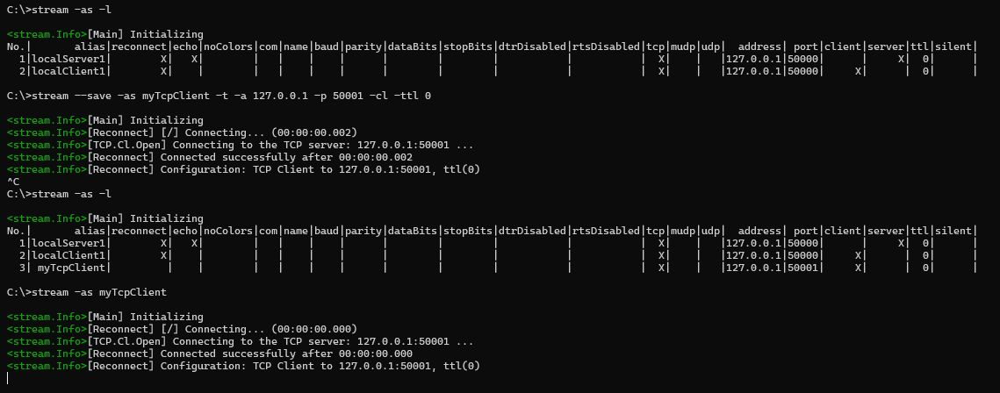
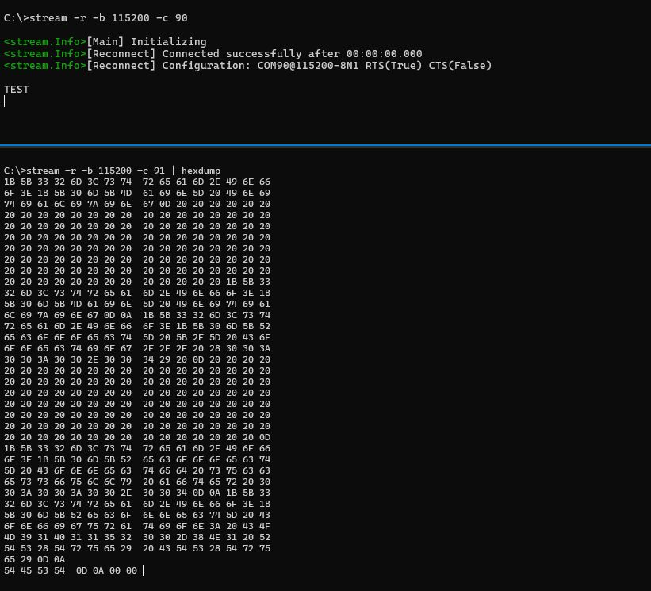
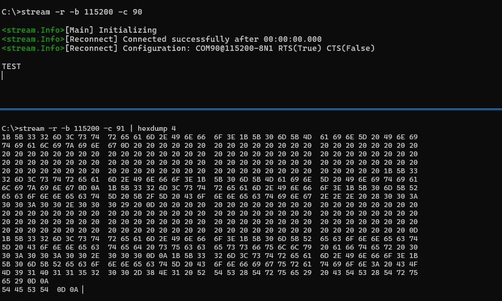

# About stream
Packet stream contains a few multipurposal application set to work with data received and transmitted via Com Port/TCP/UDP clients.
Main advantage is CLI, which can be hooked up to any other applications, by configuring the behavior of a stream by its parameters.

# List of apps:
- dumphex - program that converts ASCII representation of hexadecimal format into ASCII string;
- hexdump - converts binary stream into hexadecimal representation (can be used with regex);
- regex - regular expressions in your console!
- stream - main program, that allows to establish basic connections via COM Port, TCP/IP client/server or even UDP socket
- streamGraph - can be used to visualize decimal values given in ASCII on a chart (required VisBox.Plot);
- streamNode - communication node for other stream instances.

# Basic startup
## stream - first steps
Lets assume an device, that can be connected to by COM Port.\
Here goes stream, started as follow:\
```stream -c [COM_PORT] -b [BAUDRATE]```

To check for accessibility of given CP, you can simply type:\
```stream -c -l```
Which should gives output like this:\


As you can see, comm0com is pretty useful here. Lets establish connection between COM90 & COM91 @ 115200:\
```stream -b 115200 -c COM90``` and in the second terminal ```stream -r -b 115200 -c 91```

There are two ways to give a Com port number, by full name "COM90" or by its number "91".
```-r``` parameters is responsible for auto reconnect, when connection get lost.\


There is a stream internal message, which provides useful information, e.g. current connection configuration:\
```COM90@115200-8N1 RTS(True) CTS(True)```\
RTS and CTS are turned on by default.

## stream as tcp client-server - example
According to "help" of the stream available by calling: ```stream``` or ```stream --help```, stream can be configured as TCP client/server.\


Lets test that out. There is one server and two clients:\


Reconnect parameter was not set, but stream, always try to reconnect to server/client at least once.\
Stream always works in multi-client architecture. Whats more, the TTL parameter can be set via ```-ttl [number]```.

## stream aliases
To earn some time, aliases were added!\
List of aliases is accessible by ```stream -as -l```. You can save/modify/clear aliases by parameters ```--save``` and ```-clear```.\
To save new alias just simply add ```--save -as [ALIAS_NAME]``` somewhere in the command line:\


### hexdump
Hexdump can be connected with stream as follows:\
```stream [configuration parameters] | hexdump```



As an optional parameter, hexdump gets number of 8 wide bytes columns:\



### streamGraph
TBD

### streamNode
TBD

